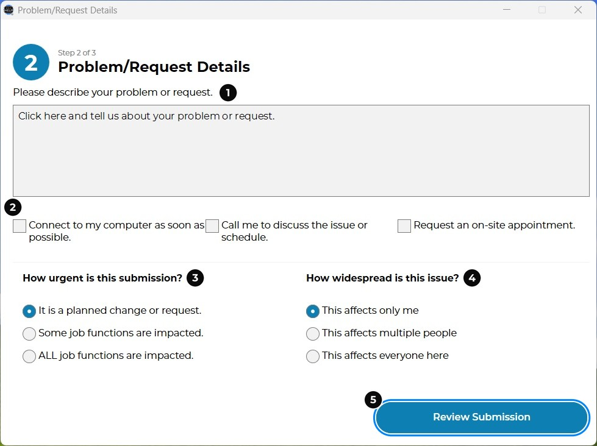

<Warning>
  Need help urgently? Call us directly at [+1 (469) 850-3968](tel:+14698503968) or email [helpdesk@wrld.tech](mailto:helpdesk@wrld.tech).
</Warning>

<Card title="Sign in to submit a ticket" icon="ticket-plus" href="https://portal.wrld.tech" cta="Open the Ticket Portal">
  Continue to the Syncro end-user portal. Sign in with Google, Microsoft, or your email address and password, then create or manage your service tickets.
</Card>

  <iframe
    className="block w-full aspect-video rounded-xl"
    src="https://www.youtube-nocookie.com/embed/DRckhDcNAds"
    title="WRLD Help Button walkthrough: submitting a ticket on Windows, Mac and the client portal"
    allow="accelerometer; autoplay; clipboard-write; encrypted-media; gyroscope; picture-in-picture; web-share"
    referrerPolicy="strict-origin-when-cross-origin"
    allowFullScreen
  ></iframe>

90-second walkthrough: open the WRLD Help Button on Windows or Mac, send your request, and sign in to the client portal.

## Get help now

<CardGroup cols={2}>
  <Card title="Call support" icon="phone" href="tel:+14698503968">
    (469) 850-3968 · critical issues answered 24/7 for managed clients
  </Card>
  <Card title="Email the help desk" icon="mail" href="mailto:helpdesk@wrld.tech">
    helpdesk{'@'}wrld.tech · tell us what happened, when, and who it affects
  </Card>
  <Card title="Client portal" icon="log-in" href="https://portal.wrld.tech">
    Sign in to open a ticket or check on one you've already sent
  </Card>
  <Card title="Install the Help Button" icon="download" href="/support/tickets/help-button-install">
    Set it up on Windows or macOS in a few minutes
  </Card>
</CardGroup>

<Tip>
  Prefer to chat? Tap the orange button in the bottom corner of this page. Standard requests are handled Monday to Friday, 10am to 6pm CT.
</Tip>

## Problem with your computer? Press WRLD HELP

The [WRLD Help Button](/support/tickets/help-button) is the fastest way to reach us about your computer, apps, email, or network. Opening it takes screenshots and runs quick checks before you type a word, so we see what you see.

<Steps>
  <Step title="Open WRLD HELP">
    On Windows, press **F1**, click the **WRLD HELP** icon in your taskbar, or <a href="tier2tickets://run" target="_self" className="link">open WRLD HELP from this page</a>. On a Mac, open it from your **Applications** folder. [More ways to open it](/support/tickets/help-button#open-the-help-button-on-windows).
  </Step>
  <Step title="Confirm your name and work email">
    The first time you use it, enter the name and work email we should reply to, then select **Describe Issue**.
  </Step>
  <Step title="Describe the problem or request">
    Tell us what happened, when it started, and how it affects your work. Choose how urgent it is and how many people it affects, then select **Review Submission**.

    <Frame caption="Describe your problem or request">
      
    </Frame>
  </Step>
  <Step title="Review, consent, and submit">
    Check the summary and the screenshots, leave out passwords or anything confidential, then select **Submit**.
  </Step>
  <Step title="Watch for your ticket number">
    You'll get a confirmation with your ticket number. We reply by email or phone, depending on what you asked for.
  </Step>
</Steps>

Don't have the Help Button yet? [Install it](/support/tickets/help-button-install), or use any option in [Get help now](#get-help-now).

## Problem with a website? Use the orange button

For issues on a WRLD website or web app, like this help center, a broken link, a page that won't load, or a form that fails, report it right from the page.

<Steps>
  <Step title="Open the orange button">
    Select the orange button in the bottom corner of the page where you see the problem.
  </Step>
  <Step title="Report the issue">
    Choose to report an issue or send feedback. A screenshot of the page is attached for you, and you can draw on it to point out what's wrong.
  </Step>
  <Step title="Describe it and send">
    Add a short description and send it. We get the page address and your browser details with it, and you can follow the conversation from the same button or by email.
  </Step>
</Steps>

## Sign in to the client portal

Already have a portal account? Open a ticket or check on an existing one in the WRLD client portal.

<CardGroup cols={2}>
  <Card title="Sign in to submit a ticket" icon="ticket-plus" href="https://portal.wrld.tech">
    Sign in with your company Google or Microsoft account, or your email address and password, then create or manage your service tickets.
  </Card>
  <Card title="Request portal access" icon="key-round" href="/support/tickets/request-portal-access">
    Can't sign in, or don't have an account yet? Here's how to get access.
  </Card>
</CardGroup>

<Info>
  Ticket submission requires a portal login, use your company email to login via the 'Google Login' or 'Microsoft Login' (based on your company platform) to access your dashboard. The portal opens at `portal.wrld.tech` and displays WRLD Tech Co. branding along with login options. The portal opens at `portal.wrld.tech` and displays WRLD Tech Co. branding. For sign-in steps, see [Client Portal Login](/support/client-login).
</Info>
