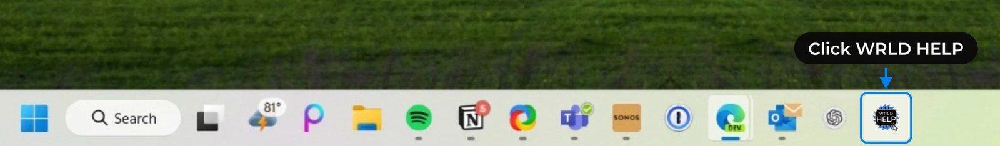

## Download & Install

The WRLD Help Button makes submitting support tickets fast and easy. Pick your operating system below and follow the steps.

<Tip>
  The download links below always point to the latest version of the Help Button, so you never need to hunt for an updated file.
</Tip>

<Tabs>
  <Tab title="Windows" icon="windows">
    <Steps>
      <Step title="Download the Installer">
        Download the Windows installer (`.msi`):

        <Card title="WRLD Help Button for Windows" icon="download" href="https://static.helpdeskbuttons.com/get_msi?userid=a3f5ef7d2e583f3e4c581a">
          Windows 10 and 11 · `.msi` installer · latest version
        </Card>

        The file will download to your default save folder (usually **Downloads**).
      </Step>
      <Step title="Run the Installer">
        Double-click the downloaded `.msi` file to run it.

        <Note>
          If Windows asks for permission, select **Yes**. If your account isn't allowed to install software, ask your IT admin to approve the install.

          IT admins can also install from an elevated terminal: open **Start**, search for **Command Prompt**, choose **Run as administrator**, and run `msiexec /i "<path to the downloaded file>.msi"`.
        </Note>
      </Step>
      <Step title="Select a Function Key">
        When prompted, choose which function key (F1–F11) opens the Help Button.

        **We recommend selecting F1** for quick access.
      </Step>
      <Step title="Restart Your Computer">
        The installer will ask you to restart. Select **Yes** to complete the installation.
      </Step>
    </Steps>

    ### Where to find it on Windows

    - **Taskbar** - Click the **WRLD HELP** icon
    - **Desktop** - Icon alongside your other desktop icons
    - **Function key** - Press the key you chose during install (for example **F1**)
    - **Link** - Click <a href="tier2tickets://run" target="_self" className="link">Open WRLD HELP</a>, or press **Windows + R** and enter `tier2tickets://run`
    - **System tray** - Right-click the tray icon

    <Frame caption="WRLD HELP pinned to the Windows taskbar">
      
    </Frame>
  </Tab>
  <Tab title="macOS" icon="apple">
    <Steps>
      <Step title="Download the Installer">
        Download the macOS installer (`.pkg`):

        <Card title="WRLD Help Button for macOS" icon="download" href="https://static.helpdeskbuttons.com/get_pkg?userid=a3f5ef7d2e583f3e4c581a">
          macOS · `.pkg` installer · latest version
        </Card>

        The file will download to your **Downloads** folder.
      </Step>
      <Step title="Run the Installer">
        Double-click the downloaded `.pkg` file and follow the prompts. Enter your Mac password when asked to allow the install.
      </Step>
      <Step title="Allow Screen Recording">
        The Help Button needs permission to capture screenshots for your ticket.

        1. Open **System Settings** → **Privacy & Security** → **Screen & System Audio Recording**.
        2. Click the **\+** button and open the **Applications** folder.
        3. Press **⌘ Command + Shift + G**, type `.Tier2SVC`, and press **Return** to select it. Then click **Open**.
        4. Make sure the toggle next to **.Tier2SVC** is turned **on**.

        <Warning>
          Without this permission, screenshots can't be attached to your tickets and the **Include Screenshots** option won't appear.
        </Warning>
      </Step>
      <Step title="Allow Input Monitoring">
        This permission is **optional**. It lets the Help Button capture the clicks leading up to your issue, so we can see exactly what happened.

        To turn it on, repeat steps 1–4 above, but in step 1 open **System Settings** → **Privacy & Security** → **Input Monitoring**. Add `.Tier2SVC` (press **Return** after typing it, then click **Open**) and turn the toggle **on**.

        <Info>
          macOS Input Monitoring also lets an app see keyboard input, not only mouse clicks. If you'd rather not grant it, skip this step: the Help Button still works and falls back to taking screenshots at regular intervals before you submit a ticket.
        </Info>
      </Step>
      <Step title="Restart and Launch">
        Restart your Mac (or log out and back in) so the new permissions take effect. Then open the Help Button from your **Applications** folder, or press **⌘ Command + Space** and search for **Help**.
      </Step>
    </Steps>

    <Note>
      When the Help Button captures your screen, macOS shows a purple indicator in the menu bar. This is normal. Newer versions of macOS may also ask you to re-confirm screen recording permission from time to time; select **Allow** to keep screenshots working.
    </Note>
  </Tab>
</Tabs>

## After Installation

When you click the Help Button, it runs a quick set of diagnostics (screenshots, logs, network checks) so our team has everything needed to help you, with no screenshots or long explanations required from you.

<Frame caption="The Help Button running its diagnostic checks">
  <video
    autoPlay
    muted
    loop
    playsInline
    poster="/images/help-button/help-button-diagnostics-poster.jpg"
    src="/images/help-button/help-button-diagnostics.mp4"
    className="w-full max-w-md mx-auto aspect-square"
  ></video>
</Frame>

<Card title="Learn how to use the Help Button" icon="circle-help" href="/support/tickets/help-button">
  See our guide on submitting tickets with the Help Button
</Card>

## Need Help?

If you run into issues during installation, contact us at [helpdesk@wrld.tech](mailto:helpdesk@wrld.tech), call **469.299.9598**, or [submit a ticket in the client portal](/support/submit-ticket).
